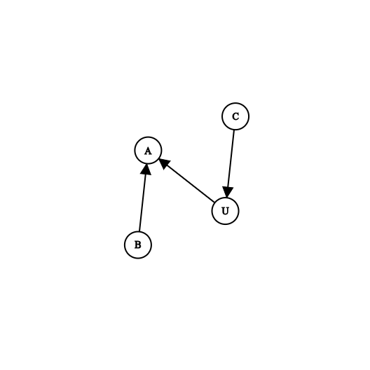
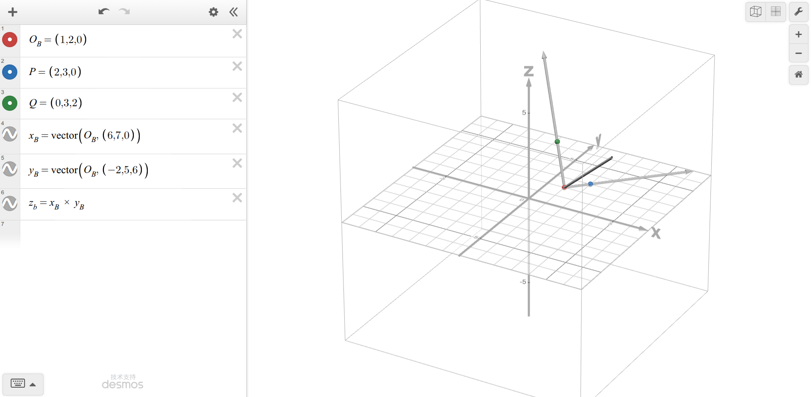
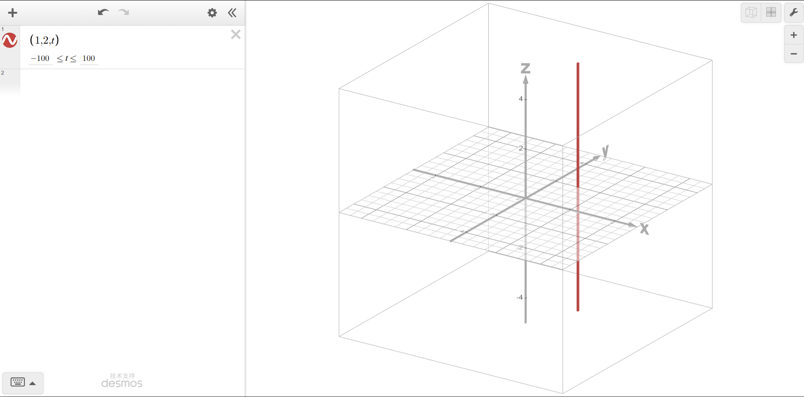
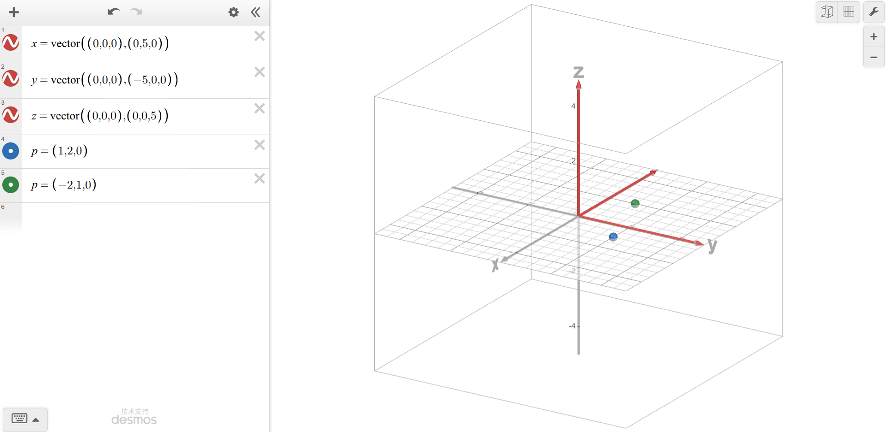

# Answer

## 1 旋转次序与符号计算

（1）设 $\set{B}$ 绕自身的 $Z_B$ 旋转后得到坐标系 $\set{B'}$，绕 $Z_{B'}$ 旋转得到 $\set{B''}$，则
$$
\begin{align}
{}_B^AR &={}_{B'}^AR\ {}_{B''}^{B'}R ={}_{B'}^BR\ {}_{B''}^{B'}R\\
&= 
\begin{bmatrix}
\cos \theta&-\sin\theta &0\\
\sin\theta&\cos\theta&0\\
0&0&1\\
\end{bmatrix}
\cdot
\begin{bmatrix}
1&0&0\\
0&\cos\phi&-\sin\phi\\
0&\sin\phi&\cos\phi
\end{bmatrix}\\
&=
\begin{bmatrix}
\cos \theta&-\sin\theta\cos\phi&\sin\theta\sin\phi\\
\sin\theta&\cos\theta\cos\phi&-\cos\theta\sin\phi\\
0&\sin\phi&\cos\phi
\end{bmatrix}
\end{align}
$$
（2）将变为
$$
{}_B^AR=R_X(\Phi)R_Z(\theta)
$$
其中，$R_Z(\theta)$ 是绕 $Z_A$ 旋转 $\theta$ 的旋转矩阵，$R_X(\phi)$ 是绕 $X_A$ 旋转 $\phi$ 的旋转矩阵。换言之，将变成左乘。此时，将旋转矩阵看成了算子。

## 2 旋转矩阵的合法性与物理意义

（1）
$$
\begin{align}
M_1M_1^T&=\begin{bmatrix}
0&-1&0\\
1&0&0\\
0&0&1
\end{bmatrix}
\begin{bmatrix}
0&1&0\\
-1&0&0\\
0&0&1
\end{bmatrix}\\
&=\begin{bmatrix}
1&0&0\\
0&1&0\\
0&0&1
\end{bmatrix}
\end{align}\\
$$

$$
\begin{align}
M_2M_2^T&=\begin{bmatrix}
1&0&0\\
0&1&0\\
0&0&-1
\end{bmatrix}
\begin{bmatrix}
1&0&0\\
0&1&0\\
0&0&-1
\end{bmatrix}\\
&=\begin{bmatrix}
1&0&0\\
0&1&0\\
0&0&1
\end{bmatrix}
\end{align},
$$

$$
\begin{align}
M_3M_3^T&=\begin{bmatrix}
1&1/5&0\\
0&1&0\\
0&0&1
\end{bmatrix}
\begin{bmatrix}
1&0&0\\
1/5&1&0\\
0&0&1
\end{bmatrix}\\
&=\begin{bmatrix}
26/25&1/5&0\\
1/5&1&0\\
0&0&1
\end{bmatrix}
\end{align},
$$

$$
\det(M_!)=1\quad \det(M_2)=-1\quad \det(M_3)=1
$$

因此，只有 $M_1$ 可以描述右手坐标系之间的姿态；

（2）因为旋转矩阵一定是正交矩阵，“可逆” 和 “行列式为 1” 都不能说明矩阵是正交矩阵，因此都不保证是旋转矩阵；

（3）记一个合法旋转矩阵为 ${}_B^AR$，则其三个列向量分别代表 $\set{B}$ 坐标系的三个单位主矢量；

## 3 工具偏置与空间变换方程

（1）闭环变换方程为
$$
{}_{W}^BT\ {}_{T}^WT={}_S^BT\ {}_G^ST\ {}_T^GT
$$
代入得到
$$
{}_W^BT=\begin{bmatrix}
0 & 0&1&350\\
1&0&0&200\\
0&1&0&50\\
0&0&0&1
\end{bmatrix}
$$
（2）设 $\set{T}$ 的坐标原点是 $\vec{P}_{TO}$，则
$$
{}^B\vec{P}_{TO实际}={}_{W}^BT\ {}_{T}^WT\vec{P}_{TO}\\
{}^B\vec{P}_{TO期望}={}_{T}^BT\ {}_{T}^WT={}_{W}^{B}T\ {}_{T}^WT\ {}_{T}^WT\vec{P}_{TO}\\
$$
于是，
$$
{}^B\vec{P}_{TO实际}-{}^B\vec{P}_{TO期望}= \begin{bmatrix}
100 & 0& 0 & 0
\end{bmatrix}^T
$$

## 4 空间尺寸链与齐次变换求解



于是，有
$$
{}_B^CT\ ={}_U^CT\ {}^U_A{T}\ {}_B^AT
$$
解得
$$
{}_B^CT = \begin{bmatrix}
    0.5335    &0.8248  & -0.1875  & -0.8332\\
   -0.8080   & 0.5625 &   0.1752 &   0.6095\\
    0.2500  &  0.0580  &  0.9665  &-35.8599\\
         0    &     0    &     0 &   1.0000
\end{bmatrix}
$$
闭环检验得到：
$$
{}_C^B T\ {}_U^C T\ {}_A^U T\ {}_N^A T= I
$$

## 5 从图形读取坐标系

对于 $i=1,2,3,4$，分别有
$$
{}^0_1T = Rot(\vec{x}, \pi)Trans([-88.9\ -76.2\ -25.4]^T) = \begin{bmatrix}
    1.0000   &      0    &     0 & -88.9000\\
         0  & -1.0000    &     0 &  76.2000\\
         0    &     0  & -1.0000 &  25.4000\\
         0    &     0    &     0 &   1.0000
\end{bmatrix}\\
{}^1_2T = Rot(\vec{y},\pi/2)Rot(\vec{z},-\pi/2)Trans([-76.2\ -25.4\ 0]^T)=\begin{bmatrix}
         0     &    0   & 1.0000  &       0\\
   -1.0000   &      0   &      0 &  76.2000\\
         0  & -1.0000   &      0  & 25.4000\\
         0    &     0   &      0 &   1.0000
\end{bmatrix}\\
{}^2_3T = Trans([0\ 127.0\ 0]^T)Rot(\vec{y}, -\pi/2)Rot(\vec{x}, \pi-\theta)=\begin{bmatrix}
         0 &  -0.8000  &  0.6000  &       0\\
         0 &  -0.6000  & -0.8000  &127.0000\\
    1.0000 &        0  &       0  &       0\\
         0 &        0  &       0  &  1.0000
\end{bmatrix}\\
{}^3_4T = Trans([88.9\ 0\ 0]^T)Rot(\vec{y}, \pi)=\begin{bmatrix}
   -1.0000  &       0&         0 &  88.9000\\
         0  &  1.0000&         0 &        0\\
         0  &       0&   -1.0000 &        0\\
         0  &       0&         0 &   1.0000
\end{bmatrix}
$$
其中，$\sin \theta = 76.2/127$。

于是，有
$$
{}_2^0T = {}_1^0T\ {}_2^1T = \begin{bmatrix}
         0  &       0 &   1.0000 & -88.9000\\
    1.0000  &       0 &        0 &        0\\
         0  &  1.0000 &        0 &        0\\
         0  &       0 &        0 &   1.0000
\end{bmatrix}\\
{}_3^0T = {}_1^0T\ {}_2^1T\ {}_3^2T = \begin{bmatrix}
    1.0000  &       0  &       0 & -88.9000\\
         0  & -0.8000  &  0.6000 &        0\\
         0  & -0.6000  & -0.8000 & 127.0000\\
         0  &       0  &       0 &   1.0000
\end{bmatrix}\\
{}_4^0T = {}_1^0T\ {}_2^1T\ {}_3^2T\ {}_4^3T = \begin{bmatrix}
   -1.0000  &       0 &        0 &        0\\
         0  & -0.8000 &  -0.6000 &        0\\
         0  & -0.6000 &   0.8000 & 127.0000\\
         0  &       0 &        0 &   1.0000
\end{bmatrix}
$$

## 6 由三点构造右手坐标系

（1）



于是，有
$$
{}_B^AR = \begin{bmatrix}
x_b\cdot x_a & y_b\cdot x_a&z_b\cdot x_a\\
x_b\cdot y_a & y_b\cdot y_a&z_b\cdot y_a\\
x_b\cdot z_a & y_b\cdot z_a&z_b\cdot z_a\\
\end{bmatrix}
= \begin{bmatrix}
1/\sqrt{2}&-1/\sqrt{6}& 1/\sqrt{3}\\
1/\sqrt{2}&1/\sqrt{6}&-1/\sqrt{3}\\
0&2/\sqrt{6}&1/\sqrt{3}
\end{bmatrix}
$$

$$
{}_B^AT = \begin{bmatrix}
1/\sqrt{2}&-1/\sqrt{6}& 1/\sqrt{3}&1\\
1/\sqrt{2}&1/\sqrt{6}&-1/\sqrt{3}&2\\
0&2/\sqrt{6}&1/\sqrt{3}&0\\
0&0&0&1
\end{bmatrix}
$$

（2）
$$
{}^BP=({}_B^AT)^{-1}\cdot {}^AP\\
{}^BQ=({}_B^AT)^{-1}\cdot {}^AQ\\
$$
解得
$$
{}^BP = \begin{bmatrix}
\sqrt{2}&0&0
\end{bmatrix}^T\\
{}^BQ = \begin{bmatrix}
0&\sqrt{6}&0
\end{bmatrix}^T\\
$$
（3）

不满足，此时，点积为正无法满足；不唯一，此时，$y_B$ 轴方向不唯一，导致坐标系不唯一。

## 7 绕不经过原点的轴旋转

（1）

三个变换矩阵分别为：
$$
T_1=\begin{bmatrix}
1 & 0& 0& -1\\
0 & 1  & 0 & -2\\
0 & 0 & 1 & 0\\
0 & 0 & 0 & 1\\
\end{bmatrix}\quad 
T_2=\begin{bmatrix}
0 & -1 & 0 & 0\\
1 & 0  & 0 & 0\\
0 & 0 & 1 & 0\\
0 & 0 & 0 & 1\\
\end{bmatrix}\quad 
T_3=\begin{bmatrix}
1 & 0 & 0 & 1\\
0 & 1 & 0 & 2\\
0 & 0 & 1 & 0\\
0 & 0 & 0 & 1\\
\end{bmatrix}
$$
于是，
$$
T = T_3T_2T_1 = \begin{bmatrix}
     0  &  -1  &   0  &   3\\
     1  &   0  &   0  &   1\\
     0  &   0  &   1  &   0\\
     0  &   0  &   0  &   1\\
\end{bmatrix}
$$


（2）
$$
p'=T\cdot p = \begin{bmatrix}
1 & 3 & 1
\end{bmatrix}^T
$$
（3）
$$
T\cdot (q+\lambda k)=\begin{bmatrix}
     0  &  -1  &   0  &   3\\
     1  &   0  &   0  &   1\\
     0  &   0  &   1  &   0\\
     0  &   0  &   0  &   1\\
\end{bmatrix}\cdot \begin{bmatrix}
1\\
2\\
\lambda\\
1
\end{bmatrix} = \begin{bmatrix}
1\\
2\\
\lambda\\
1
\end{bmatrix}
$$
因此保持不动。

因为旋转轴不经过原点，所以在原点看来，不仅发生了旋转，还发生了一段平移。

## 8 重复复合旋转与等效轴角

（1）

两次旋转的旋转矩阵分别是：
$$
R_1 = \begin{bmatrix}
1 & 0 & 0\\
0 & 0 & -1\\
0 & 1 & 0
\end{bmatrix}\quad 
R_1 = \begin{bmatrix}
0 & -1 & 0\\
1 & 0 & 0\\
0 & 0 & 1
\end{bmatrix}
$$
于是，有
$$
R = R_2R_1 = \begin{bmatrix}
     0  &   0  &   1\\
     1  &   0  &   0\\
     0  &   1  &   0\\
\end{bmatrix}
$$
（2）

解得
$$
p_1=\begin{bmatrix}
     3\\
     2\\
     2\\
\end{bmatrix}\quad 
p_2=\begin{bmatrix}
     2\\
     3\\
     2\\
\end{bmatrix}\quad
p_3=\begin{bmatrix}
     2\\
     2\\
     3\\
\end{bmatrix}
$$
最少正整数操作次数为 $3$ 次。

（3）

由
$$
\text{tr}(R)=1+2\cos\theta
$$
得
$$
\theta=\dfrac{2\pi}{3}
$$
由
$$
o_z-a_y = 2k_z/\sin\theta\\
a_x-n_z = 2k_y/\sin\theta\\
n_y-o_{x}=2k_z/\sin\theta
$$
得
$$
k_x= \begin{bmatrix}
\dfrac{1}{\sqrt{3}} & \dfrac{1}{\sqrt{3}} & \dfrac{1}{\sqrt{3}}
\end{bmatrix}
$$
（4）

不相同，会变成 $1$ 次。

## 9 点方向与速度的坐标变换

（1）

计算得到
$$
{}^Ap_0=\begin{bmatrix}
     2\\
     0\\
     5\\
     1\\
\end{bmatrix}\quad
{}^Av=\begin{bmatrix}
    -1\\
     0\\
    -1\\
     0
\end{bmatrix}\quad
{}^Ad=\begin{bmatrix}
     0\\
     1\\
     0\\
     0
\end{bmatrix}
$$
（2）

先运动再变换得到：
$$
{}^Ap = {}^A_BT\cdot ({}^Bp_0+2\ {}^Bv) = \begin{bmatrix}
     0\\
     0\\
     3\\
     1
\end{bmatrix}
$$
先变换再运动得到：
$$
{}^Ap = {}^Ap_0+2\ {}^Av = \begin{bmatrix}
0\\
0\\
3\\
1
\end{bmatrix}
$$
（3）

因为速度和方向矢量是单纯的矢量，只指示方向，与起始点无关，所以可以任意平移。

## 10 齐次变换求逆

令 $T = \begin{bmatrix}R&p\\0&1\end{bmatrix}$，则有
$$
T^{-1}=\begin{bmatrix}
R^T&(-R^T)p\\
0 & 1
\end{bmatrix} = \begin{bmatrix}
     0  &   0  &  -1  &   0\\
     1  &   0  &   0  &   1\\
     0  &  -1  &   0  &   2\\
     0  &   0  &   0  &   1
\end{bmatrix}
$$


## 11 坐标轴描述与 ZYZ 欧拉角

（1）
$$
{}_B^AR = \begin{bmatrix}
x_b\cdot x_a & y_b\cdot x_a&z_b\cdot x_a\\
x_b\cdot y_a & y_b\cdot y_a&z_b\cdot y_a\\
x_b\cdot z_a & y_b\cdot z_a&z_b\cdot z_a\\
\end{bmatrix} = \begin{bmatrix}
1 & 0 & 0\\
0 & 0 & 1\\
0 & -1 & 0
\end{bmatrix}
$$
（2）

ZYZ 通式为
$$
R = \begin{bmatrix}
c_\alpha c_\beta c_\gamma - s_\alpha s_\gamma & -c_\alpha c_\beta s_\gamma - s_\alpha c_\gamma & c_\alpha s_\beta \\
s_\alpha c_\beta c_\gamma + c_\alpha s_\gamma & -s_\alpha c_\beta s_\gamma + c_\alpha c_\gamma & s_\alpha s_\beta \\
-s_\beta c_\gamma & s_\beta s_\gamma & c_\beta
\end{bmatrix}
$$
对照得到：
$$
c_\beta = 0
$$
于是
$$
\beta = \dfrac{\pi}2
$$
化简得到
$$
R = \begin{bmatrix}
- s_\alpha s_\gamma & - s_\alpha c_\gamma & c_\alpha \\
 c_\alpha s_\gamma &  c_\alpha c_\gamma & s_\alpha \\
- c_\gamma & s_\gamma & 0
\end{bmatrix}
$$
于是，
$$
-s_\gamma = 1\quad \dfrac{s_\alpha}{s_\gamma} = -1
$$
得到
$$
\gamma= -\dfrac{\pi}{2}\quad \alpha = \dfrac{\pi}2
$$
验证得到
$$
\begin{bmatrix}
0 & -1 & 0\\
1 & 0 & 0\\
0 & 0 & 1\\
\end{bmatrix}\begin{bmatrix}
0 & 0 & 1\\
0 & 1 & 0\\
-1 & 0 & 0\\
\end{bmatrix}\begin{bmatrix}
0 & 1 & 0\\
-1 & 0 & 0\\
0 & 0 & 1\\
\end{bmatrix} = \begin{bmatrix}
1 &  0 & 0\\
0 & 0 & 1\\
0 & -1 & 0
\end{bmatrix}
$$

## 12 ZYX 欧拉角反解与奇异性

ZYX 欧拉角矩阵通式为：
$$
R =\begin{bmatrix}
c_\alpha c_\beta & -s_\alpha c_\gamma+c_\alpha s_\beta s_\gamma & s_\alpha s_\gamma + c_\alpha s_\beta c_\gamma\\
s_\alpha s_\beta & c_\alpha c_\gamma + s_\alpha s_\beta s_\gamma & -c_\alpha s_\gamma + s_\alpha s_\beta c_\gamma\\
-s_\beta & c_\beta s_\gamma & c_\beta c_\gamma
\end{bmatrix}
$$
（1）

由通式，有
$$
-s_\beta = -1
$$
解得
$$
\beta = \dfrac{\pi}{2}
$$
（2）

代入 $\beta = \pi/2$，通式变为
$$
R =\begin{bmatrix}
0 & -s_\alpha c_\gamma+c_\alpha s_\gamma & s_\alpha s_\gamma + c_\alpha c_\gamma\\
0 & c_\alpha c_\gamma + s_\alpha s_\gamma & -c_\alpha s_\gamma + s_\alpha c_\gamma\\
-1 & 0 & 0
\end{bmatrix}=\begin{bmatrix}
0 & \sin(\gamma-\alpha) & \cos(\gamma-\alpha)\\
0 & \cos(\gamma-\alpha) & -\sin(\gamma-\alpha\\
-1 & 0 & 0
\end{bmatrix}
$$
于是可以得到：
$$
\sin(\gamma-\alpha)=-\sqrt{3}/2\quad \cos(\gamma-\alpha)=1/2
$$
即
$$
\gamma-\alpha = -\pi / 3
$$
因此不能分别唯一确定。

（3）

两组解分别是
$$
(\pi/3, \pi/2, 0)\quad (\pi/2, \pi/2,\pi/6)
$$
全部等价解的形式是：
$$
(\theta+\pi/3, \pi/2,\theta)
$$
（4）

不成立，根据第（3）问，显然有无数组解。

## 13 变换的可交换情形

因为完全展开进行计算过于麻烦，使用 `MATLAB` 进行验算，代码如下：

```matlab
clear; clc;

syms kx ky kz alpha beta d real
assume(kx^2 + ky^2 + kz^2 == 1);

R = @(th) [ ...
    kx^2*(1-cos(th))+cos(th),   kx*ky*(1-cos(th))-kz*sin(th), kx*kz*(1-cos(th))+ky*sin(th);
    ky*kx*(1-cos(th))+kz*sin(th), ky^2*(1-cos(th))+cos(th),     ky*kz*(1-cos(th))-kx*sin(th);
    kz*kx*(1-cos(th))-ky*sin(th), kz*ky*(1-cos(th))+kx*sin(th), kz^2*(1-cos(th))+cos(th)];

T_R  = @(th) [R(th), zeros(3,1); 0 0 0 1];
T_T  = [eye(3), d*[kx;ky;kz]; 0 0 0 1];

syms ax ay az bx by bz real
T_T1 = [eye(3), [ax;ay;az]; 0 0 0 1];
T_T2 = [eye(3), [bx;by;bz]; 0 0 0 1];

disp('===== 证明一 =====');
disp(simplify(T_R(alpha)*T_T - T_T*T_R(alpha)));

disp('===== 证明二 =====');
disp(simplify(T_T1*T_T2 - T_T2*T_T1));

disp('===== 证明三 =====');
disp(simplify(T_R(alpha)*T_R(beta) - T_R(beta)*T_R(alpha)));
```

## 14 一般轴旋转公式的推导

建立参考坐标系 $\set{A}$，并建立坐标系 $\set{B}$，$\set{B'}$，$\set{A'}$，其中，$\set{B}$ 初始时与 $\set{A}$ 重合，$\set{B'}$ 初始时与 $\set{A'}$ 重合。$\set{A'}$ 与 $\set{A}$ 原点重合，都是 $\vec{k}$ 的起点，$\set{A'}$ 的 $z$ 轴与 $\vec{k}$ 重合。设
$$
{}_{A'}^AR = \begin{bmatrix}
n_x&o_x&k_x\\
n_y&o_y&k_y\\
n_z&o_z&k_z
\end{bmatrix}
$$
于是，有
$$
\begin{align}
{}_B^AR=R(\vec{k},\theta)&={}_{A'}^{A}R\ {}_{B'}^{A'}R\ {}_B^{B'}R\\
&= \begin{bmatrix}
n_x&o_x&k_x\\
n_y&o_y&k_y\\
n_z&o_z&k_z
\end{bmatrix}\begin{bmatrix}
\cos\theta&-\sin\theta&0\\
\sin\theta &\cos\theta & 0\\
0 & 0 & 1\\
\end{bmatrix}\begin{bmatrix}
n_x&n_y&n_z\\
o_x&o_y&o_z\\
k_x&k_y&k_z
\end{bmatrix}\\
&= \begin{bmatrix}
n_xc_\theta + o_xs_\theta&-n_xs_\theta+o_xc_\theta & k_x\\
n_yc_\theta+o_ys_\theta & -n_ys_\theta+o_yc_\theta& k_y\\
n_zc_\theta+o_zs_\theta&-n_zs_\theta+o_zc_\theta & k_z
\end{bmatrix}\begin{bmatrix}
n_x&n_y&n_z\\
o_x&o_y&o_z\\
k_x&k_y&k_z
\end{bmatrix}\\
&= \begin{bmatrix}
k_xk_x(1-c_\theta)+c_\theta & k_xk_y(1-c_\theta)-k_zs_\theta&k_xk_z(1-c_\theta)+k_ys_\theta\\
k_xk_y(1-c_\theta)+k_zs_\theta&k_yk_y(1-c_\theta)+c_\theta&k_yk_z(1-c_\theta)-k_xs_\theta\\
k_xk_z(1-c_\theta)-k_ys_\theta&k_yk_z(1-c_\theta)+k_xs_\theta&k_zk_z(1-c_\theta)+c_\theta
\end{bmatrix}\\
&= \cos\theta I+(1-\cos\theta)kk^T+\sin\theta[k]_\times
\end{align}
$$

## 15 无穷小旋转的一阶近似

当 $\varepsilon$ 很小时，有
$$
\cos\varepsilon\approx1\quad \sin \varepsilon\approx\varepsilon
$$
于是，有
$$
\begin{bmatrix}
k_xk_x(1-c_\theta)+c_\theta & k_xk_y(1-c_\theta)-k_zs_\theta&k_xk_z(1-c_\theta)+k_ys_\theta\\
k_xk_y(1-c_\theta)+k_zs_\theta&k_yk_y(1-c_\theta)+c_\theta&k_yk_z(1-c_\theta)-k_xs_\theta\\
k_xk_z(1-c_\theta)-k_ys_\theta&k_yk_z(1-c_\theta)+k_xs_\theta&k_zk_z(1-c_\theta)+c_\theta
\end{bmatrix}\approx\begin{bmatrix}
1 & -k_z\varepsilon &k_y\varepsilon\\
k_z\varepsilon&1&-k_x\varepsilon\\
-k_y\varepsilon&k_x\varepsilon&1
\end{bmatrix}=I+\varepsilon[k]_\times
$$

$$
\cos\theta I+(1-\cos\theta)kk^T+\sin\theta[k]_\times \approx I + \epsilon[k]_\times
$$

## 16 等效轴角的特殊情形

（1）

由
$$
\text{tr}(R_1)=1+2\cos\theta
$$
得
$$
\cos\theta = -1
$$
于是，
$$
\theta = \pi
$$
设 $\hat{\bold{k}}=(x,y,z)$，则
$$
\begin{bmatrix}
0 & 1 & 0\\
1 & 0 & 0\\
9 & 9 & -1
\end{bmatrix}\begin{bmatrix}
x\\y\\z
\end{bmatrix} = \begin{bmatrix}
x\\y\\z
\end{bmatrix}
$$
于是，有
$$
\begin{cases}
y=x\\
x = y\\
-z = z
\end{cases}
$$
再由 $||\bold{k}||=1$，得到
$$
\bold{k}=\pm\begin{bmatrix}
1/\sqrt{2}&1/\sqrt{2}&0
\end{bmatrix}^T
$$
（2）

因为 $\sin\theta$ 是 $0$，$1/\sin\theta$ 无意义。

（3）

对于 $R_2$，有
$$
1+2\cos\theta = 3
$$
因此有
$$
\theta = 0
$$
此时，解
$$
Rk=k
$$
可以得到无数个解。

因此，对于 $R_1$ 和 $R_2$，转轴都不唯一。但改变转轴符号都不影响旋转的结果。

## 17 主动旋转与被动坐标变换

（1）

根据转动过程，有
$$
{}_B^AR = \begin{bmatrix}
0 & -1 &0\\
1 & 0 & 0\\
0 & 0 & 1
\end{bmatrix}
$$
于是，有
$$
{}^Bp = {}_A^BR\cdot {}^Ap = \begin{bmatrix}
0 & 1 & 0\\
-1 & 0 & 0\\
0 & 0 & 1
\end{bmatrix}
\begin{bmatrix}
1\\2\\0
\end{bmatrix} = \begin{bmatrix}
2\\
-1\\
0
\end{bmatrix}
$$
（2）

此时，有
$$
p' = R_1p = \begin{bmatrix}
0 & -1 &0\\
1 & 0 & 0\\
0 & 0 & 1
\end{bmatrix}\begin{bmatrix}
1\\2\\0
\end{bmatrix} = \begin{bmatrix}
-2\\
1\\
0
\end{bmatrix}
$$
（3）



第（1）问中，坐标系正向旋转，相当于 $p$ 点逆向旋转，而第（2）问 $p$ 点正向旋转，因此两次的旋转矩阵互为逆矩阵。

## 18 正交矩阵乘积的性质

$$
(Q_1Q_2)(Q_2Q_1)^T = (Q_1Q_2)(Q_2^TQ_1^T)=I
$$

因此，$Q_1Q_2$ 也是正交矩阵。

而
$$
\det(Q_1Q_2)=\det(Q_1)\det(Q_2)=1
$$

## 19 旋转保持叉积

令
$$
R=\begin{bmatrix}
\bold{r_1}&\bold{r_2}&\bold{r_3}
\end{bmatrix}
$$
于是，有
$$
R(a\times b)=R\begin{bmatrix}
-z_ay_b+y_az_b\\
z_ax_b-x_az_b\\
-y_ax_b+x_ay_b
\end{bmatrix}=(-z_ay_b+y_az_b)r_1+(z_ax_b-x_az_b)r_2+(-y_ax_b+x_ay_b)r_3
$$
而
$$
\begin{align}
(Ra)\times (Rb)&=(x_ar_1+y_ar_2+z_ar_3)\times(x_br_1+y_br_2+z_br_3)\\
&= x_ax_b(r_1\times r_1)+x_ay_b(r_1\times r_2)+x_az_b(r_1\times r_3)\\
&+y_ax_b(r_2\times r_1)+y_ay_b(r_2\times r_2)+y_az_b(r_2\times r_3)\\
&+z_ax_b(r_3\times r_1)+z_ay_b(r_3\times r_2)+z_az_b(r_3\times r_3)\\
&=x_ay_br_3-x_az_br_2-y_ax_br_3+y_az_br_1+z_ax_br_2-z_ay_br_1\\
&=(-z_ay_b+y_az_b)r_1+(-x_az_b+z_ax_b)r2+(x_ay_b-y_ax_b)r_3
\end{align}
$$
得证。

## 20 标量三重积

$$
\begin{align}
a\cdot(b\times c) &= \begin{bmatrix}
a_1 & a_2 & a_3
\end{bmatrix}\cdot\begin{bmatrix}
-b_3c_2+b_2c_3\\
b_3c_1-b_1c_3\\
-b_2c_1+b_1c_2
\end{bmatrix}\\
&= -a_1b_3c_2+a_1b_2c_3+a_2b_3c_1-a_2b_1c_3-a_3b_2c_1+a_3b_1c_2
\end{align}
$$

$$
\begin{align}
(a\times b)\cdot c &= \begin{bmatrix}
-a_3b_2+a_2b_3\\
a_3b_1-a_1b_3\\
-a_2b_1+a_1b_2
\end{bmatrix}\cdot\begin{bmatrix}
c_1\\c_2\\c_3
\end{bmatrix}\\
&= -a_3b_2c_1+a_2b_3c_1+a_3b_1c_2-a_1b_3c_2-a_2b_1c_3+a_1b_2c_3
\end{align}
$$

## 21 单个点约束下的旋转非唯一性

（1）

对于绕 $X_AY_AZ_A$ 的旋转，记 $R =R_Z(\gamma)R_Y(\beta)R_X(\alpha)$，令 $\gamma=\beta=0$，解得
$$
\alpha = \arctan(5/12)\quad\beta=0\quad\gamma=0
$$
回代得到
$$
Rp=\begin{bmatrix}
1 & 0 & 0\\
0 & 12/13 & -5/13\\
0&5/13 & 12/13
\end{bmatrix}\begin{bmatrix}
2\\3\\2
\end{bmatrix}=\begin{bmatrix}
2\\2\\3
\end{bmatrix}
$$
对于绕 $Z_AY_AZ_A$ 的旋转，记 $R=R_Z(\gamma)R_Y(\beta)R_Z(\alpha)$，令
$$
\alpha= 90^\circ\quad \beta=90^\circ\quad \gamma=0
$$
回代得到
$$
Rp=\begin{bmatrix}
0 & 0 & 1\\
0 & 1 & 0\\
-1 & 0 & 0
\end{bmatrix}\begin{bmatrix}
0 & -1 & 0\\
1 & 0 & 0\\
0 & 0 & 1
\end{bmatrix}\begin{bmatrix}
2\\3\\2
\end{bmatrix}=\begin{bmatrix}
2\\2\\3
\end{bmatrix}
$$
对于绕 $Z_AX_AZ_A$ 的旋转，记 $R=R_Z(\gamma)R_X(\beta)R_Z(\alpha)$，令
$$
\alpha=0\quad \beta=\arctan(5/12)\quad \gamma=0
$$
则与绕 $X_AY_AZ_A$ 的旋转相同。

（2）

给定点 $p$ 和 $p'$，可以确定一个旋转轴和一个旋转角度。但将 $p$ 旋转到 $p'$ 后，绕任意过 $p'$ 的轴旋转任意角度都是合法的，因此姿态不固定。

## 22 特征值与旋转轴的物理意义

对于特征值为 $1$ 的特征向量，有
$$
Rv = 1\cdot v= v
$$
因此，$v$ 在经过 $R$ 对应的旋转后保持不变，换言之，$v$ 是 $R$ 对应矩阵的旋转轴。

当 $R\neq I$ 时，存在唯一的旋转轴。当 $R=I$ 时，因为对于任意的向量 $v$，都有 $Rv=v$，因此此时不存在唯一的旋转轴。

## 23 旋转乘法的可交换性

构造两个矩阵如下：
$$
R_x(90^\circ)=\begin{bmatrix}
1 & 0 & 0\\
0 & 0 & -1\\
0 & 1 & 0
\end{bmatrix}\\
R_y(90^\circ)=\begin{bmatrix}
0 & 0 & 1\\
0 & 1 & 0\\
-1 & 0 & 0
\end{bmatrix}\\
$$
于是，
$$
R_x(90^\circ)R_y(90^\circ)=\begin{bmatrix}
0 & 1 & 0\\
0 & 0 & -1\\
-1 & 0 & 0
\end{bmatrix}\\
R_y(90^\circ)R_x(90^\circ)=\begin{bmatrix}
0 & 0 & 1\\
1 & 0 & 0\\
0 & 1 & 0
\end{bmatrix}\\
$$
证明见第 13 问。

因为绕同一轴分别以不同顺序旋转角度 $\theta$、$\gamma$，等价于绕该轴旋转角度 $\theta+\gamma$，因此是可交换的。
