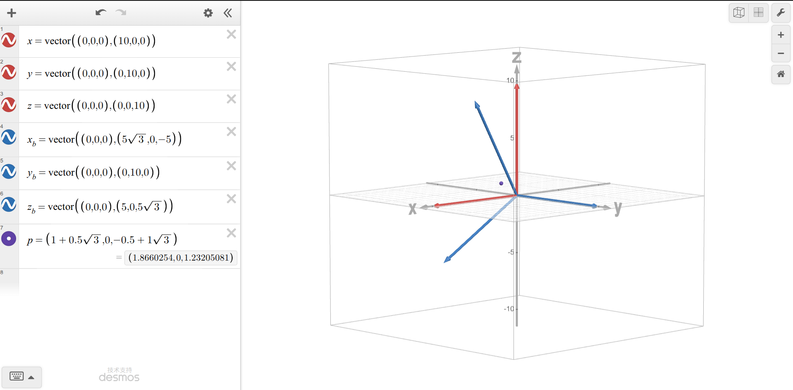

# Report

## 1. 源代码

```matlab
function R = zyx_euler(alpha, beta, gamma)
% 给定三个角度值，计算旋转矩阵

a = deg2rad(alpha);
b = deg2rad(beta);
c = deg2rad(gamma);

R_x = [1, 0, 0;
    0, cos(c), -sin(c);
    0, sin(c), cos(c)];
R_y = [cos(b), 0, sin(b);
    0, 1, 0;
    -sin(b), 0, cos(b)];
R_z = [cos(a), -sin(a), 0;
    sin(a), cos(a), 0;
    0, 0, 1];

R = R_z * R_y * R_x;

end
```

```matlab
function [alpha, beta, gamma, alpha_, beta_, gamma_] = zyx_euler_inverse(R)
% 给定旋转矩阵 R，反解 alpha，beta 和 gamma，角度限制在 (-180, 180]
% 非奇异情况下，给出两组解 [alpha, beta, gamma] 以及 [alpha_, beta_, gamma_]
% 奇异情况下，给出一组代表解 [alpha, beta, gamma[
% 奇异情况下，beta_ 作为奇异信号，值为 -180, alpha_ 表示 beta_ 符号，gamma 给出自由参数关系

eps = 1e-9;
if norm(R'*R - eye(3), 'fro') > eps
    error('不是正交矩阵');
end
if abs(det(R) - 1) > eps
    error('行列式不为 1');
end

beta = rad2deg(asin(-R(3,1)));

if (abs(abs(R(3,1)) - 1) < eps)
    beta_ = -180;
    if (abs(R(3, 1) + 1) < eps)
        gamma = 0;
        alpha = rad2deg(atan2(-R(1,2), R(2,2)));
        alpha_ = 1;
        gamma_ = alpha - gamma;
    else
        gamma = 0;
        alpha = rad2deg(atan2(-R(1,2), R(2,2)));
        alpha_ = -1;
        gamma_ = alpha + gamma;
    end
else
    alpha = rad2deg(atan2(R(2,1), R(1,1)));
    gamma = rad2deg(atan2(R(3,2), R(3,3)));
    beta_ = 180 - beta;
    if beta_ > 180
        beta_ = beta_ - 360;
    end
    alpha_ = mod(alpha + 180 + 180, 360) - 180;
    gamma_ = mod(gamma + 180 + 180, 360) - 180;
end

end
```

```matlab
clear;clc;
format short e;

cases = [20, 30, 10;
    25, 90, -45;
    -35, -90, 15];

%% (a) 正解
disp('(a)');
for i = 1:3
    R = zyx_euler(cases(i,1), cases(i,2), cases(i,3));
    disp([norm(R'*R-eye(3),'fro'), abs(det(R)-1), norm(inv(R)-R','fro')]);
end

%% (b) 反解
disp('(b)');
for i = 1:3
    R = zyx_euler(cases(i,1), cases(i,2), cases(i,3));
    [a,b,g,a_,b_,g_] = zyx_euler_inverse(R);
    disp([a,b,g,a_,b_,g_]);
end

%% (c) 闭环
disp('(c)');
for i = 1:3
    R1 = zyx_euler(cases(i,1), cases(i,2), cases(i,3));
    [a,b,g,~,~,~] = zyx_euler_inverse(R1);
    R2 = zyx_euler(a,b,g);
    disp(norm(R1-R2,'fro'));
end

%% (d) 坐标变换
disp('(d)');
A_R_B = zyx_euler(0,30,0);
A_p = A_R_B * [1;0;2];
disp(A_p);

%% (e) 非法矩阵
disp('(e)');
try
    zyx_euler_inverse(diag([1,1,-1]));
catch ME
    disp(ME.message);
end

try
    zyx_euler_inverse([1, 1/5, 0; 0, 1, 0; 0, 0, 1]);
catch ME
    disp(ME.message);
end
```

## 2. 输出结果与说明

**（a）**

```
(a)
   2.2291e-16   2.2204e-16   1.2481e-16

   4.7103e-16   2.2204e-16   4.0792e-16

   1.5701e-16   1.1102e-16   1.7554e-16
```

令旋转矩阵 $R=[r_1,r_2,r_3]$，则三个单位长度条件为：
$$
||r_1||=||r_2||=||r_3||=1
$$
三个两两正交条件为：
$$
r_1\cdot r_2=r_2\cdot r_3 = r_3\cdot r_1 = 0
$$
**（b）**

```
(b)
   2.0000e+01   3.0000e+01   1.0000e+01  -1.6000e+02   1.5000e+02  -1.7000e+02

    70    90     0     1  -180    70

  -2.0000e+01  -9.0000e+01            0  -1.0000e+00  -1.8000e+02  -2.0000e+01
```

**（c）**

```
(c)
   3.9252e-17

   2.3173e-16

   8.1695e-17
```

容差使用 `eps = 1e-9`。

**（d）**

```
(d)
   1.8660e+00
            0
   1.2321e+00
```



**（e）**

```
(e)
行列式不为 1
不是正交矩阵
```

